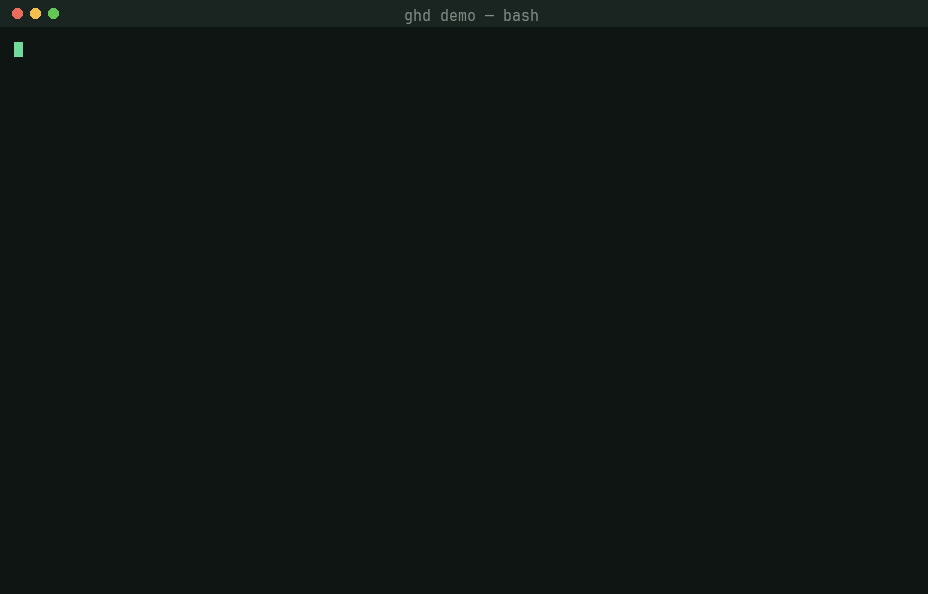
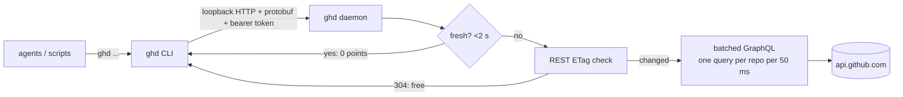

# ghd

**A per-user daemon in front of the GitHub API, so agents that loop on `gh`
stop burning the shared GraphQL budget.**

[](https://github.com/forge-ci/ghd/actions/workflows/ci.yml)
[](LICENSE)

[](https://forge-ci.github.io/ghd/)

▶ **[Play the interactive demo](https://forge-ci.github.io/ghd/)**: a real
recorded session against GitHub, with chapters and the numbers it measured.

## The problem

Every `gh pr view`, `gh pr checks` and `gh api graphql` call spends points
from one 5,000-point/hour GraphQL budget per user. A handful of agents
polling PRs in loops drain it, and then everyone sees
`GraphQL: API rate limit already exceeded for user ID …`.

## Before / after

|  | `gh` | `ghd` |
|---|---|---|
| Command | `gh pr view 2138 --json state,title` | `ghd pr view 2138 --json state,title` |
| Output | gh's JSON | the same fields and values |
| Fresh read latency | ~480 ms | **~5 ms** |
| 10 concurrent reads (5 PRs × 2), cold | ~10 points | **2 points** |
| The same 10 reads, warm | ~10 points | **0 points** |

Numbers come from the demo and the spike. In a live check on 2026-10-25, one
`ghd api graphql` call went upstream, and 5 parallel identical calls after
it were all served `fresh`.

## Quickstart

```sh
# Run straight from git (pin a commit SHA for reproducibility):
uvx --from git+https://github.com/forge-ci/ghd@<sha> ghd --help

# Or install it as a tool:
uv tool install git+https://github.com/forge-ci/ghd
```

```console
$ ghd pr view 2138 -R talos-hq/clud --json number,state,title,mergedAt
{
  "mergedAt": "2026-10-24T21:12:09Z",
  "number": 2138,
  "state": "MERGED",
  "title": "fix(gc): retry a locked registry …"
}
```

The daemon starts itself on first use; there is nothing to configure.

> **PyPI:** the `ghd` name on PyPI is only a 0.0.0 reservation today.
> `pip install ghd` will work with the first real release.

## How it saves budget



A `pr view` is answered by the cheapest step that can prove the data fresh:

| step | cost | when |
|---|---|---|
| `fresh` | 0 | validated in the last 2 s (`GHD_FRESH_MS`); concurrent identical reads wait on one per-PR lock |
| `revalidated` | **0** | the PR's REST ETag returns `304 Not Modified`, which GitHub does not count against the rate limit |
| `fetched` | ~1 GraphQL point **per batch** | every PR of one repo requested within 50 ms goes into **one** aliased GraphQL query |

`ghd api graphql` uses the same idea for arbitrary queries: identical
concurrent queries share one upstream call, and an answer is reused for the
fresh window, which is exactly what an agent's re-check loop hits.

## Command reference

```text
ghd pr view <number> [-R owner/repo] --json f1,f2   like `gh pr view --json`
ghd api graphql -f query=... [-f k=v] [-F k=v]      like `gh api graphql`
ghd gh <args...>                                    forward to real gh safely
ghd stats                                           what the daemon saved
ghd daemon                                          run the daemon (auto-started)
ghd --version | --help
```

**`ghd pr view`**
- Same output as `gh pr view --json`. Without `-R`, the repository comes
  from the `origin` remote, as with `gh`.
- The direct batched GraphQL path supports the plain scalars: `additions`,
  `baseRefName`, `body`, `changedFiles`, `closed`, `closedAt`, `createdAt`,
  `deletions`, `headRefName`, `headRefOid`, `id`, `isDraft`,
  `mergeStateStatus`, `mergeable`, `mergedAt`, `number`, `state`, `title`,
  `updatedAt` and `url`.

- Nested fields such as `reviews`, `author`, `labels` and `statusCheckRollup`
  use the shared resource reader described below, also available to Python.

**Resource and collection reads**

`ghd issue view 42 -R owner/repo --json number,title` and `ghd issue list
-R owner/repo --json number,title --limit 10` cache canonical JSON in the
daemon. PR list/checks and run view/list use the same reader. Field order,
subsets, supersets, `--jq` and templates share data; filter values, run attempts,
hosts and credential identities stay separate. Missing fields trigger a union
fetch. Pending checks preserve gh exit 8; failed checks preserve exit 1.

Lists share up to 100 rows across requested limits. Larger limits retain gh's
native pagination and cache exact output. A reached limit never establishes
that the collection is complete. Run collections use conditional REST GETs
when the selected fields come from that collection; a 304 reuses the retained
body. `workflowName` and jobs require native gh metadata reads. JSON nulls and
nested data preserve gh's output, including nested member order.

Diagnostic (`GH_DEBUG`/`DEBUG`) and forced-terminal reads execute directly;
credential-bearing API traces are never cached. Exit status follows real gh:
for example, gh 2.98's JSON checks exporter returns 0 for pending checks,
while its plain output returns 8. ghd retains each result's actual status.

Headless cached reads require an explicit repository (`-R`, a repository view
selector, or `GH_REPO`). Unbound, interactive, watch and unsupported shapes
retain real gh behavior. The existing scalar `pr view` path still resolves
`origin` and batches GraphQL. Other recognized safe families cache exact gh
output; see the [command matrix](docs/GHX_PARITY.md#read-command-matrix).

Python has the same behavior through `ghd.bindings.gh_read(args)`, returning
stdout/stderr bytes, exit code, source and `limit_reached`. The existing
`pr_view()` binding accepts nested fields too. jq and templates use real gh's
renderer on a private authenticated loopback body, with separate credentials
and no external proxy access.

**`ghd api graphql`**
- Takes gh's `-f` (string) and `-F` (typed, `@file`) fields and prints
  GitHub's body.
- Queries are deduplicated and cached for the fresh window.
- Mutations always go upstream and clear the query cache, so no read
  returns data from before a write.
- A body with `errors` is printed and the command exits 1, as with gh.

**`ghd stats`** prints the daemon's counters as JSON: `reads`,
`served_fresh`, `sentinel_304_free`, `sentinel_200`, `graphql_queries`,
`graphql_prs_fetched`, `graphql_points_spent`, `api_graphql_upstream`,
`api_graphql_served_fresh`, `graphql_remaining`, `core_remaining` and
`uptime_secs`.

**`ghd daemon`** runs the daemon in the foreground. You rarely need it: one
start lock means concurrent cold clients start exactly one daemon.

## Forwarding commands and writes

`ghd gh <args...>` forwards arguments and the original stdin/stdout/stderr to
real GitHub CLI when the shape is not eligible for a cached read. Eligible
headless reads go through the daemon's shared reader. Unknown top-level
commands also pass through. A request already dispatched to a daemon is never
replayed as a fallback. `GHD_GH_PATH` selects a real `gh` executable explicitly. Recursive
shims are rejected.

Known safe reads pass through without a write fence. Mutations and unknown
commands record an intent in the shared write journal before dispatch. Every
daemon checks the journal before and after cached reads. A completed write
advances the generation and invalidates PR, raw GraphQL and resource-read caches,
including results still in flight. This also works when a daemon was stopped
while a subprocess performed the write.

A failed, interrupted or uncertain write leaves an intent visible across
restarts. Cached reads then fail explicitly rather than silently returning
pre-write data. This conservative policy includes nonzero subprocess exits;
`pr checks` pending exit 8 is a known read and does not create an intent.
Do not remove the journal to bypass an unresolved write: confirm the writer's
completion before recovery. The cache-management recovery command is being
implemented with the lifecycle controls under issue #14.

Native GraphQL requests parse the complete document, honor `operationName`
and refuse malformed, ambiguous or subscription operations before upstream
execution. Typed `-F query=@-` reads stdin, as does real gh's passthrough path.

## Configuration

| variable | effect |
|---|---|
| `GHD_STATE_DIR` | absolute private state root override; invalid relative paths fail |
| `GHD_GH_PATH` | real GitHub CLI executable for passthrough and credential lookup |
| `GHD_FRESH_MS` | fresh window in milliseconds (default 2000), read once at daemon start |
| `GHD_DEBUG` | when set, prints which step (`fresh`, `revalidated`, `fetched`) answered each read |
| `GHD_EXE` | the `ghd` executable used to start the daemon, if not the current one |
| `GH_TOKEN` / `GITHUB_TOKEN` | the token the daemon uses; falls back to `gh auth token` |

## GitHub identities and Enterprise

Each call resolves the selected GitHub hostname and credential before looking
up a daemon. Daemons, caches, startup locks and logs are partitioned by a
cryptographic fingerprint of both values; raw tokens never appear in paths.
Token rotation selects a new daemon. Existing legacy endpoint files are ignored.

Use `GH_HOST` to select a host, `ghd pr view 12 -R git.example.com/owner/repo
--json state` to bind a repository host, or `ghd api graphql --hostname
git.example.com -f 'query={viewer{login}}'`. `GH_REPO` supplies the default
repository before the origin remote. Conflicting explicit host selectors fail.

For github.com and subdomains of ghe.com, credentials use `GH_TOKEN`, then
`GITHUB_TOKEN`. Other hosts use `GH_ENTERPRISE_TOKEN`, then
`GITHUB_ENTERPRISE_TOKEN`. If neither is set, `gh auth token --hostname HOST`
resolves the stored credential. A missing credential fails before cache access.
The Python `pr_view` binding uses the same resolver and accepts a
`hostname/owner/repo` repository selector.

## Use it with agents

The point of `ghd` is to sit under tools that call GitHub in loops. A real
consumer: [obs-rust/obs-studio](https://github.com/obs-rust/obs-studio)
routes every GraphQL call through

```sh
uv run --no-project --script ci/gh_graphql.py ...
```

which wraps `ghd`, and its agent PreToolUse hook bans bare
`gh api graphql`, so no agent session can bypass the cache by accident.
The same pattern works anywhere:

1. Pin `ghd` with `uvx --from git+https://github.com/forge-ci/ghd@<sha> ghd`.
2. Point your scripts' `gh pr view --json` and `gh api graphql` calls at it.
3. Add a hook or lint rule that rejects the bare `gh` forms.
4. Watch `ghd stats` to see what was saved.

Python callers can also use the bundled extension:

```python
from ghd.bindings import pr_view
pr_view("talos-hq/clud", 2138, ["state", "mergeable"])
```

## Architecture

| crate | role |
|---|---|
| `crates/ghd` | the public amalgam: `pub use` re-exports only; feature `daemon` |
| `crates/ghd-cli` | the `ghd` binary (bundled into the wheel by soldr) |
| `crates/ghd-py` | the PyO3 `_native` extension (client side only) |
| `crates/private/ghd-core` | wire protocol, endpoint file, loopback client, gh-compatible CLI |
| `crates/private/ghd-daemon` | loopback server, cache, sentinels, GraphQL batcher |
| `crates/private/ghd-platform` | the only crate with host-specific code (`cfg_select!` once) |

- The CLI client is std-only; it talks to the daemon over loopback HTTP with
  protobuf bodies and a bearer token.
- The daemon is built on [kernal-api](https://crates.io/crates/kernal-api)
  (async engine, HTTP client and server, JSON, secure random). No crate
  names tokio, reqwest or hyper directly.
- Every third-party dependency is pinned with `=`.
- More: [DESIGN.md](DESIGN.md) (including the roadmap: checks, lists,
  issues, writes and watches), [docs/ARCHITECTURE.md](docs/ARCHITECTURE.md)
  and [crates/README.md](crates/README.md).

## Development

```sh
./test        # soldr cargo test --workspace, build + install the wheel, pytest
./lint        # rustfmt, clippy -D warnings, ruff
uv run --no-project --script ci/local.py precheck   # ci-lint precheck (also a hook)
```

CI is declared, not scripted: [`ci.toml`](ci.toml) (profile
`rust-pypi-app`) is the contract, checked by
[`ci-lint`](https://github.com/zackees/ci.yml). Repo rules, gates and hooks
are in [CLAUDE.md](CLAUDE.md).

## Releases

Merge a commit to main that bumps `[workspace.package].version` in
`Cargo.toml` and `version` in `pyproject.toml`. CI then builds every
platform's wheel, verifies them, tags the commit and publishes to PyPI with
no stored secrets. See [RELEASE.md](RELEASE.md).

## License

[MIT](LICENSE)
